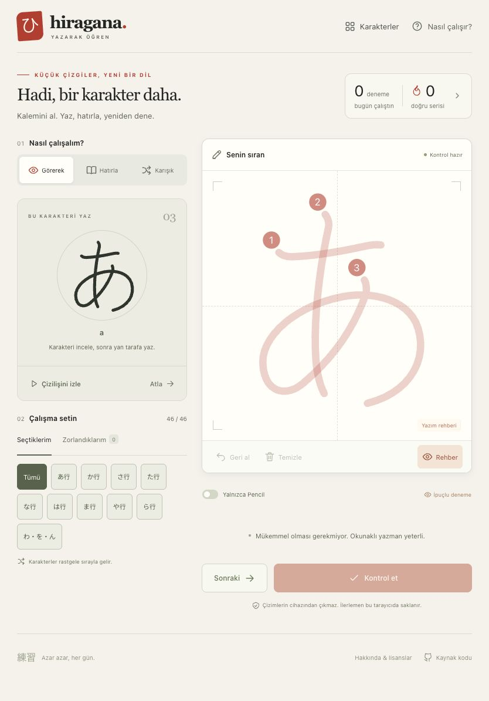

# Hiragana · Yazarak öğren

A quiet handwriting practice space for the **46 basic hiragana**, designed around an iPad and Apple Pencil. The interface is in Turkish. A real neural character recognizer runs entirely in your browser.

**[Open the app](https://berkopan.github.io/practice-hiragana/)** · [How recognition works](docs/recognition.md) · [Licenses](THIRD_PARTY_NOTICES.md)



*iPad portrait preview. The screenshot is CC BY-SA 3.0; see [guide attribution](DATA_SOURCES.md#documentation-preview).*

## Practice

| Mode | What you see | What you do |
| --- | --- | --- |
| **Görerek** | A handwritten hiragana reference and its romaji | Copy the character |
| **Hatırla** | Romaji only | Write the corresponding hiragana from memory |
| **Karışık** | A random mix of both | Alternate recognition and recall |

Choose kana rows, practice the whole set, or revisit characters you last got wrong with **Zorlandıklarım**. A shuffled bag varies the order and avoids consecutive repeats when the selection contains more than one character. The character table also lets you jump directly to any kana.

The writing area supports Pencil pressure, coalesced pointer events, undo, clear, and a **Yalnızca Pencil** switch that ignores finger input. Mouse input remains available on a computer. Vector strokes survive layout and orientation changes. **Çizilişini izle** animates a reference; **Rehber** adds a tracing guide with numbered stroke starts.

### On iPad

1. Open the app in Safari and wait for **Kontrol hazır**.
2. Choose **Görerek**, **Hatırla**, or **Karışık** and the rows you want to practice.
3. Enable **Yalnızca Pencil** if your palm or fingers leave marks.
4. Write one large character in the square, then tap **Kontrol et**.
5. Use Safari → Share → **Add to Home Screen** for an app-like window.

The drawing square captures gestures; the rest of the page remains scrollable. Undo removes one stroke. A clear or uncertain result can be retried. An uncertain prediction is **not counted as a wrong answer**. A successfully checked unchanged drawing cannot inflate the statistics through repeated taps. Hint-assisted attempts are identified and included in the recorded totals.

## Real recognition, no server

The app uses [DaKanji Single Character Recognition v2.0](https://github.com/dariyooo/DaKanji-Single-Kanji-Recognition/releases/tag/v2.0), a small quantized CNN, with [ONNX Runtime Web](https://onnxruntime.ai/docs/tutorials/web/). The model is about 2.23 MB; the WebAssembly engine is an additional approximately 14.85 MB before HTTP compression. These are downloaded from the same site, not from a runtime CDN.

Only your ink reaches the recognizer. Grid lines, stroke numbers, and tracing guides are excluded. The app crops and normalizes the drawing, runs the complete Japanese-character classifier in a dedicated worker, and compares its prediction with the requested character **after** inference. The requested answer is not sent to the model. Low-confidence or ambiguous outputs return an uncertain result. There are no hand-coded acceptance shapes for individual kana.

**The check evaluates recognizable character shape, not stroke order or calligraphic quality.** The instructional stroke animation is separate. A neural classifier can still misread a malformed drawing; model scores are not a calibrated percentage of handwriting correctness. See the [model notes](docs/recognition.md) for preprocessing, decision thresholds, reproducible regression checks, and observed limitations.

### Privacy and offline use

- No account, API key, analytics, third-party fonts, or handwriting upload.
- Progress and preferences are stored in this browser's localStorage. They do not sync between devices. Clearing site data removes them.
- The installed service worker caches the complete app, model, and runtime for offline practice after its first successful installation. Browser storage policies can evict this cache; first use requires a connection.
- Updated versions are installed as complete cache sets. Close existing app tabs and reopen to activate an already-downloaded update.

## Development

Use **Node.js 24 LTS** (22.12+ supported), npm, and Python 3.10+. Python is used only for a standard-library build-time download, not by the website.

```sh
npm ci
npm run dev
```

`predev` and `prebuild` fetch the pinned model if needed. Both the release archive and extracted weights are verified against committed SHA-256 hashes. The 2.23 MB weights stay out of Git history; the build copies the verified file into `dist/models/`. This also keeps the website self-contained after deployment. Do not replace a missing download with unverified model bytes.

```sh
npm test              # pure logic tests + real WebAssembly model regression
npm run build        # typecheck, production build, complete offline cache
npx playwright install chromium webkit
npm run test:e2e      # production app at /practice-hiragana/, Chromium + iPad WebKit
npm run preview
```

The browser suite covers all 46 reference kana through the actual drawing and worker pipeline, wrong-character rejection, uncertainty without a penalty, persistence, undo/clear, touch filtering, resize behavior, responsive geometry, and recognition after an offline reload. Synthetic reference checks are integration/regression tests; they are **not a human handwriting accuracy estimate**. WebKit device emulation does not reproduce physical Apple Pencil hardware.

The source is a static React + TypeScript + Vite application. There is no backend and no environment file to configure.

## GitHub Pages

This repository uses the workflow in [`.github/workflows/pages.yml`](.github/workflows/pages.yml). On pushes to `main`, it downloads the verified model, runs tests, builds the site, tests Chromium and WebKit, and deploys the artifact. Pull requests run the same checks without publishing. Actions are pinned to commit hashes; deployment receives only the Pages and OpenID permissions it needs.

For a fork, set **Settings → Pages → Build and deployment → Source → GitHub Actions** once, then push or run the workflow. The ordinary workflow token cannot enable a disabled Pages site by itself. Relative asset paths support repository subpaths and custom domains. If you rename the repository, update the public URL and repository links in the README and `src/App.tsx`.

## Licenses and attribution

| Component | License | Scope |
| --- | --- | --- |
| Original application code and design | MIT | [LICENSE](LICENSE) |
| DaKanji model and labels | MIT, upstream release | [Model notice](public/licenses/dakanji.txt), [pinned provenance](public/models/provenance.json) |
| KanjiVG-derived stroke data and reference fixtures | CC BY-SA 3.0 | [Data sources](DATA_SOURCES.md), [retained license](public/licenses/kanjivg.txt) |
| ONNX Runtime, React, and build dependencies | Their respective notices | [Third-party notices](THIRD_PARTY_NOTICES.md) |

**Character recognition powered by machine learning from Dariyooo (DaAppLab).**

KanjiVG is copyright Ulrich Apel and contributors. Its derived data retains the attribution and share-alike license; the app's MIT license does not relabel that data. Upstream credits the ETL Character Database and KanjiVG as model-training sources; this repository does not redistribute the raw ETL dataset or claim it is MIT-licensed. Full runtime notices are available within the website under **Hakkında & lisanslar**.

## Current scope

The exercise set is the modern basic 46-character chart. Dakuten/handakuten, small kana, compound syllables, katakana drills, pronunciation scoring, and automatic stroke-order grading are not included. Primary romaji uses Hepburn (`shi`, `chi`, `tsu`, `fu`); `wo` is used for を so it can be distinguished from お in recall prompts.
